# Laboratorio de Active Directory con Windows Server 2025

Laboratorio práctico para aprender a montar un dominio de Active Directory desde cero, documentado paso a paso con capturas. Es parte de mi preparación hacia roles de soporte TI y SOC / Blue Team.

**Estado:** laboratorio base completado. Dominio `lab.local` con un controlador de dominio, un cliente Windows 11 unido, OU, usuarios, un grupo y una GPO comprobada. Próximo paso: revisar los eventos de inicio de sesión en el Visor de eventos.

## Entorno

| Elemento | Detalle |
|---|---|
| Equipo anfitrión | Windows, 16 GB de RAM |
| Virtualización | VMware Workstation |
| Servidor | Windows Server 2025 (evaluación, Desktop Experience), 3 GB de RAM, 2 procesadores, disco de 50 GB |
| Red | NAT, subred 192.168.150.0/24 |
| Dominio | `lab.local` (NetBIOS: `LAB`) |

## Pasos realizados

### 1. Crear la VM del servidor
Se creó la máquina virtual con el ISO de evaluación oficial de Microsoft, 3 GB de RAM, 2 procesadores, disco de 50 GB (sin reservar todo el espacio) y adaptador de red en modo NAT. Después de instalar, se desconectó el ISO (CD/DVD con "Connect at power on" desmarcado).

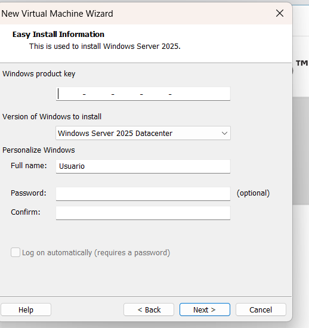
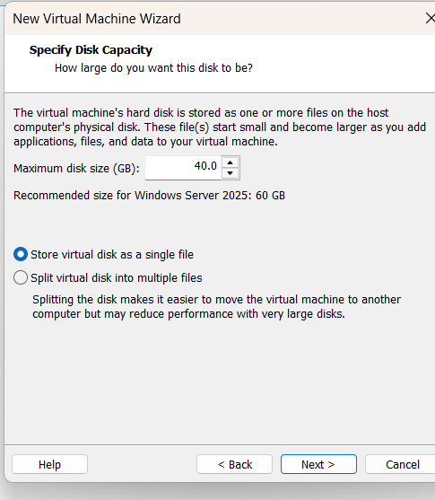
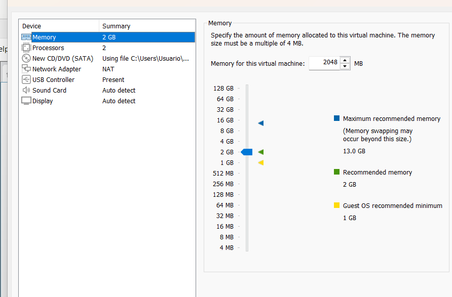

### 2. IP fija
Se asignó una IP fija dentro de la red NAT de VMware. El DNS apunta al propio servidor, porque Active Directory depende del DNS que él mismo aloja.

| Parámetro | Valor |
|---|---|
| IP | 192.168.150.10 |
| Máscara | 255.255.255.0 |
| Puerta de enlace | 192.168.150.2 |
| DNS | 192.168.150.10 |

Prueba de conectividad: `ping 8.8.8.8` con 4 paquetes enviados y 4 recibidos.

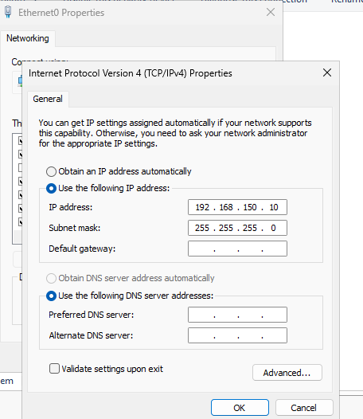

### 3. Renombrar el servidor
Se renombró a **DC01** desde `sysdm.cpl` y se reinició, antes de instalar el rol (renombrar después de promover a controlador de dominio complica las cosas).

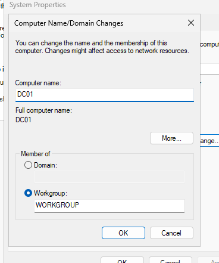

### 4. Instalar el rol AD DS
Server Manager > Manage > Add Roles and Features > **Active Directory Domain Services**. También se instalaron las herramientas de administración y **Group Policy Management**.

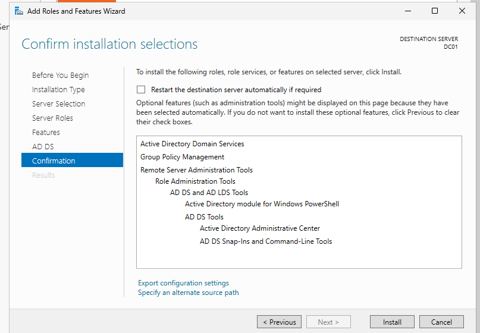
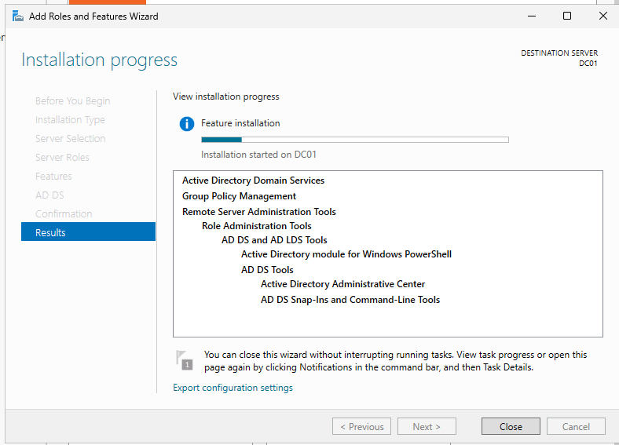
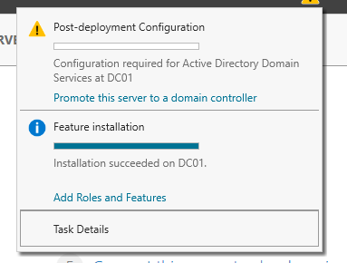

### 5. Promover el servidor a controlador de dominio
Bandera amarilla > Promote this server to a domain controller > **Add a new forest** con el dominio `lab.local`. Se dejó DNS y catálogo global activados, y se ignoró el aviso de delegación DNS, normal en un laboratorio sin zona padre.

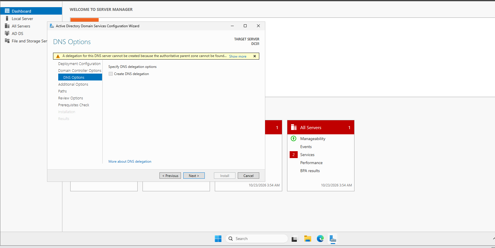
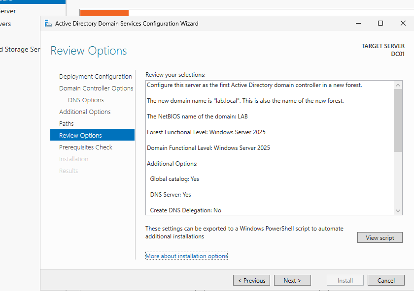

### 6. Verificar el dominio
Tras el reinicio automático se inició sesión como `LAB\Administrator`. En Server Manager aparecen los roles AD DS y DNS en estado correcto, y en **Local Server** el equipo figura como `DC01` dentro del dominio `lab.local`.

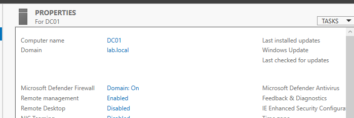

### 7. Estructura de OU, usuarios y grupo
Desde **Active Directory Users and Computers** (`dsa.msc`) se creó la unidad organizativa `Laboratorio` con dos OU dentro: `Usuarios` y `Equipos`. En `Usuarios` se crearon dos usuarios de prueba (nombres ficticios) y el grupo de seguridad `Soporte` (ámbito Global), al que se agregaron ambos usuarios.

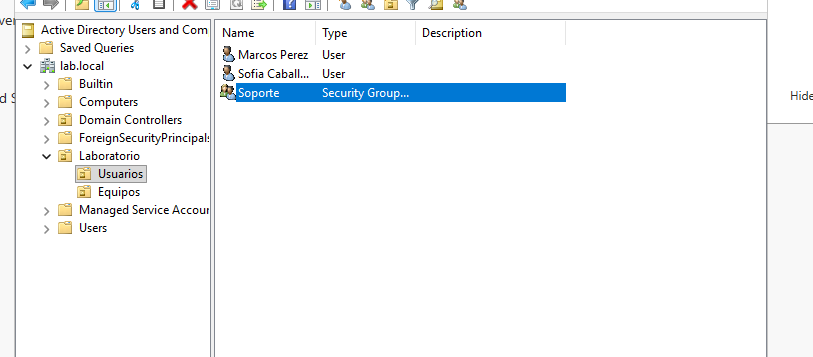

### 8. Cliente Windows 11: red y prueba de DNS
Se creó una segunda VM con Windows 11 Enterprise (evaluación), con 4 GB de RAM, 2 procesadores, disco de 64 GB y red NAT. Se le configuró una IP fija en la misma subred, con el **DNS apuntando al controlador de dominio**. Se comprobó la conectividad con `ping` al servidor y la resolución del dominio con `nslookup lab.local`, que devuelve la IP de DC01.

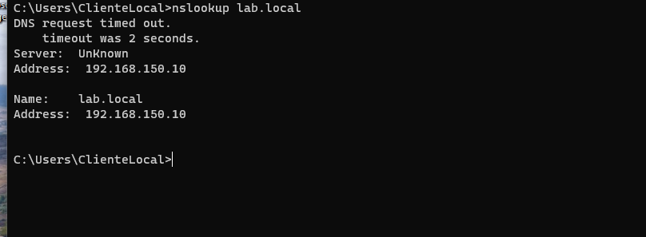

> El mensaje "DNS request timed out" y `Server: UnKnown` que aparece antes del resultado es normal: el cliente intenta una consulta inversa (de IP a nombre) y no existe una zona inversa en el laboratorio. Lo importante es que `lab.local` se resuelve correctamente.

### 9. Unir el cliente al dominio e iniciar sesión con un usuario del dominio
El equipo se renombró a `WIN11-CLIENTE` y se unió a `lab.local` desde `sysdm.cpl`, con las credenciales del administrador del dominio. Después de reiniciar, `systeminfo` muestra `Domain: lab.local` y la IP fija del cliente.

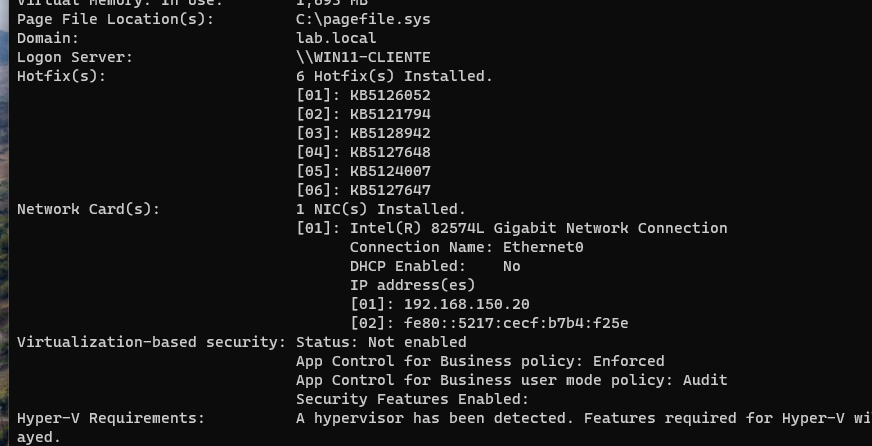

Se inició sesión con un usuario del dominio (`LAB\usuario1`). `whoami` devuelve la cuenta del dominio y `%logonserver%` muestra `\\DC01`, lo que prueba que el controlador de dominio validó el inicio de sesión.

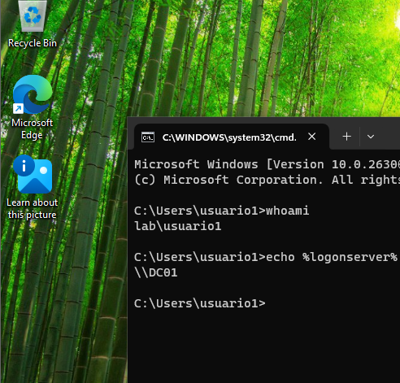

Al unirse, el equipo se registra automáticamente en el contenedor `Computers` del dominio.

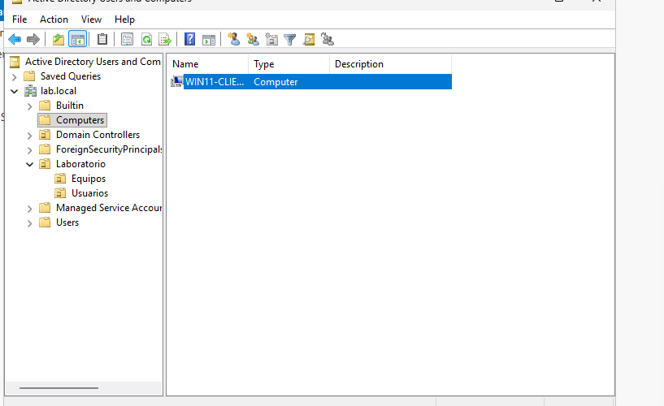

Después se movió a la OU `Laboratorio > Equipos`, para poder aplicarle políticas de forma organizada.

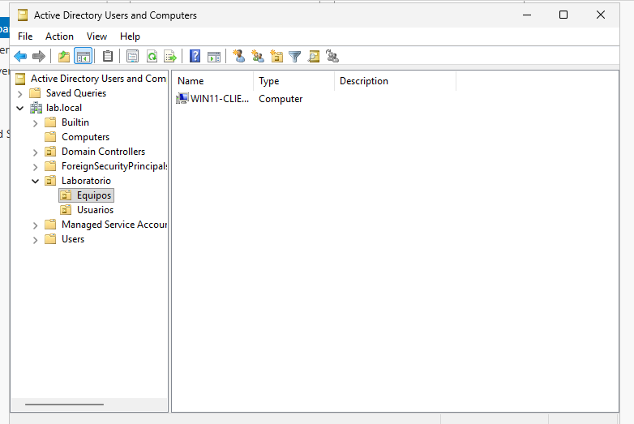

### 10. Política de grupo (GPO)
Desde **Group Policy Management** (`gpmc.msc`) en DC01 se creó la GPO `Bloquear Panel de control` y se vinculó a la OU `Laboratorio > Usuarios`. En su configuración de usuario (`User Configuration > Policies > Administrative Templates > Control Panel`) se activó **Prohibit access to Control Panel and PC settings**.

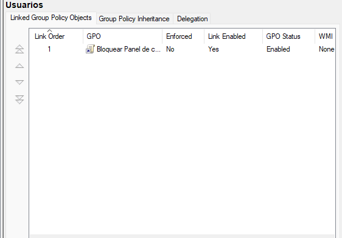

En el cliente se aplicó con `gpupdate /force` y se volvió a iniciar sesión con el usuario del dominio. Al intentar abrir el Panel de control, Windows muestra el aviso de restricción, lo que comprueba que la política se aplica a los usuarios de esa OU.

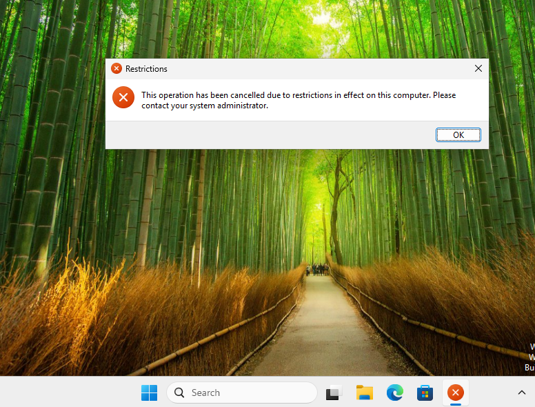

## Problemas encontrados y cómo se resolvieron

**1. La contraseña DSRM fue rechazada.**
No cumplía la complejidad de Windows. Solución: usar 8 caracteres o más, combinando al menos tres de estos tipos: mayúsculas, minúsculas, números y símbolos.

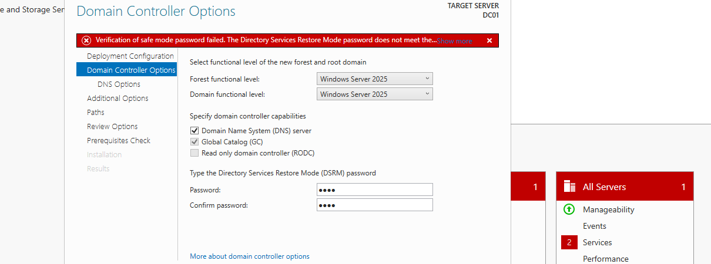

**2. Falló el chequeo de requisitos previos (Prerequisites Check).**
La cuenta local Administrator tenía la contraseña en blanco, y al crear el dominio esa cuenta pasa a ser el administrador del dominio. Solución, desde CMD como administrador:

```
net user Administrator *
```

Luego se ejecutó de nuevo el chequeo (Rerun prerequisites check). Tras el reinicio se inicia sesión como `LAB\Administrator`.

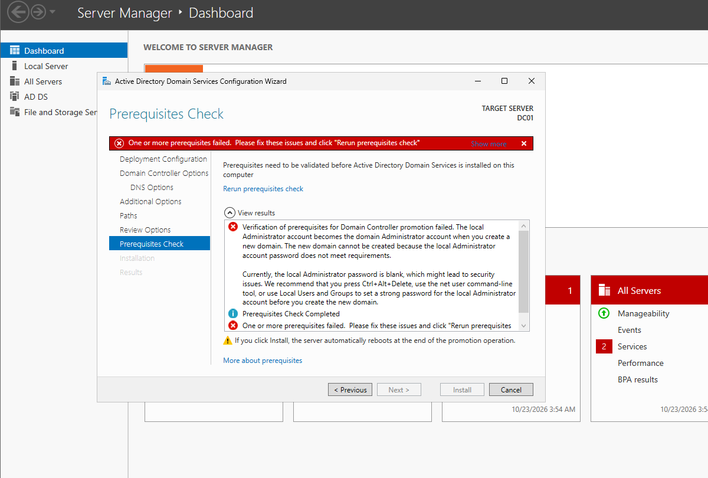

**3. Ctrl+Alt+Del dentro de la VM.**
El atajo lo recibe el equipo anfitrión. Solución: menú VM > Send Ctrl+Alt+Del.

**4. Windows 11 no se podía instalar en el disco de 50 GB.**
El instalador mostraba "Windows 11 can't be installed on this drive": Windows 11 exige un mínimo de 64 GB. Solución: apagar la VM y ampliar el disco a 64 GB desde VM > Settings > Hard Disk > Utilities > Expand.

**5. Aviso de VMware sobre el dispositivo sata0:1.**
Era la unidad de CD/DVD apuntando a un ISO ya no disponible. Solución: desmarcar "Connect at power on" en la configuración del CD/DVD.

## Conceptos aprendidos

- **Active Directory Domain Services (AD DS):** directorio central de usuarios, equipos y grupos de una organización. El controlador de dominio verifica los inicios de sesión (autenticación).
- **GPO (Group Policy):** reglas que se aplican automáticamente a usuarios y equipos del dominio.
- **DNS en Active Directory:** los equipos encuentran al controlador de dominio mediante DNS, por eso el cliente debe usar como DNS la IP del servidor.
- **Máscara de red 255.255.255.0:** los tres primeros números identifican la red y el último identifica al equipo dentro de ella.

## Pendiente

- [x] Verificar el reinicio e iniciar sesión como `LAB\Administrator`
- [x] Crear OU, usuarios de prueba y un grupo (`dsa.msc`)
- [x] Crear la VM de Windows 11, configurar su IP y DNS, y unirla al dominio
- [x] Crear una GPO, aplicarla con `gpupdate /force` y comprobarla
- [x] Hacer snapshots de las dos VMs


## Notas

Las contraseñas de este laboratorio son solo para pruebas y no se incluyen en este repositorio ni en las capturas.
